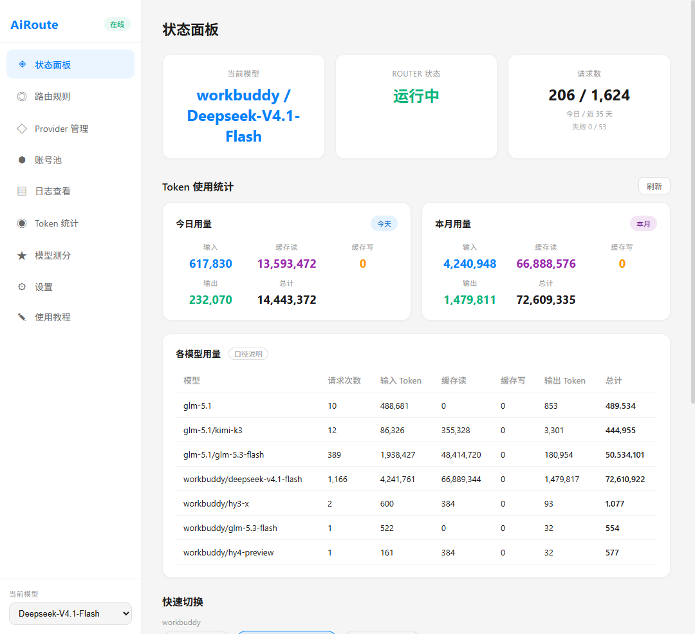
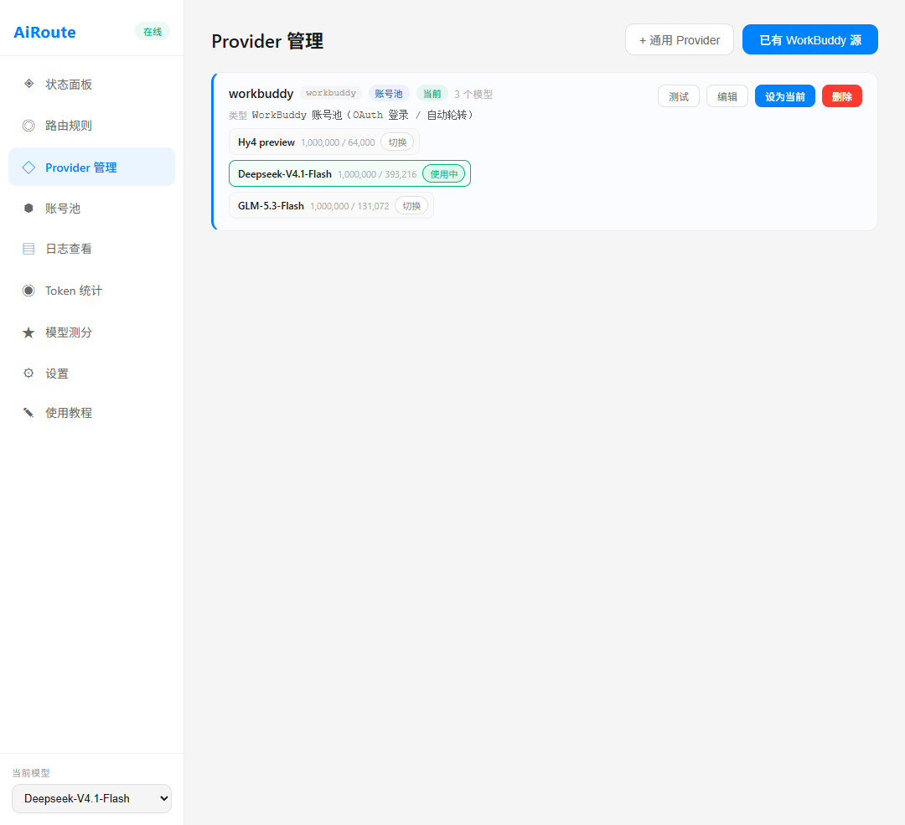

# AiRoute

> 把腾讯 **WorkBuddy（CodeBuddy）账号积分变成本地 LLM 网关** —— OAuth 登录即用，不用 API Key、不用单独充值。
> 多账号积分自动轮转、快过期的先花、签到与成长任务自动赚积分，本机所有 AI 客户端共用一个入口。

[](https://github.com/c347087870/AiRoute)
[](https://nodejs.org)
[](LICENSE)
[](https://pnpm.io)

---

> **免责声明**：本项目仅供学习和研究使用。使用者需遵守 WorkBuddy 服务条款，自行承担使用风险（包括账号封禁、条款违约等）。作者不对任何因使用本项目产生的直接或间接损失负责。

> **打赏支持**：如果 AiRoute 帮到了你，欢迎打赏一下，支持作者持续维护。
>
> 

---

## 为什么用 AiRoute

如果你手上有 WorkBuddy 账号，它的积分是**会过期**的——放着不用就白白浪费。AiRoute 要解决的就是这件事：

| 你会遇到的情况 | AiRoute 的做法 |
|---|---|
| 有多个账号，积分分散、记不住哪个快过期 | 账号池统一调度，**快过期的积分优先消耗**（168 小时窗口内优先），闲置账号补偿加权 |
| 积分到期了才发现没用完 | 到期时间逐笔可见（积分构成页），余额变动有完整流水 |
| 每次都要手动签到、做成长任务才有点数 | 签到 / 旅行 / 活跃 / 保活 / 夜猫子 / 成长任务**全部自动执行**，按你配置的时点跑 |
| 想让 Claude Code、Cursor 都能用这些积分 | OAuth 登录后即成为标准 Provider，本机任意客户端指向 `http://localhost:3000` 即可 |
| 单账号额度不够、偶尔限流 | 多号自动轮转、失败自动换号，对客户端完全透明 |
| 不知道自己到底花了多少 | 按账号 / 按模型统计请求数、Token、积分扣除与「平均积分每 1M」 |

**一句话**：登录你的 WorkBuddy 账号，剩下的交给 AiRoute——它替你花积分、也替你赚积分。

> 除 WorkBuddy 外，AiRoute 也支持任意 OpenAI / Anthropic 兼容的上游（见「其他能力」），但**核心是 WorkBuddy 账号池**。

---

## 界面预览

**状态面板**（当前模型、请求统计、Token 用量、模型芯片快速切换）



**Provider 管理**（上游增删改查、连通性测试、单模型切换）



---

## 快速开始

### 方式一：下载即用（推荐）

到 [Releases](https://github.com/c347087870/AiRoute/releases) 下载对应的安装包，无需安装任何依赖。文件名里的 `<架构>` 按机器选 `x64`（Intel / AMD）或 `arm64`（Apple Silicon / Windows on ARM）：

- **Windows**：`AiRoute-<版本>-x64.exe` 或 `AiRoute-<版本>-arm64.exe`，便携版，双击即用
- **macOS**：`AiRoute-<版本>-arm64.dmg`（Apple Silicon）或 `AiRoute-<版本>-x64.dmg`（Intel），打开后把 AiRoute 拖入「应用程序」

> macOS 包未公证，首次打开若被 Gatekeeper 拦下：右键 `AiRoute.app` → 打开，或执行 `xattr -cr /Applications/AiRoute.app`。

首次启动后三步：

1. **添加账号**：打开「账号池 → + 添加账号」，浏览器完成 OAuth 授权（无需 API Key）
2. **启用模型**：在「模型和档位」页签点「拉取上游模型」，勾选要用的模型并保存
3. **切过去用**：状态面板点一下模型芯片，或在侧边栏下拉里选中 `workbuddy/模型ID`

然后把任意客户端指向 `http://localhost:3000`（见「接入客户端」）。

> **更新**：启动后会静默检查 GitHub Releases，有新版本时侧边栏会提示，可在应用内直接下载新版安装包；也可在「设置 → 关于与更新」手动检查。

### 方式二：源码运行

前置条件：[Node.js](https://nodejs.org) >= 18、[pnpm](https://pnpm.io) >= 10

```bash
git clone https://github.com/c347087870/AiRoute.git
cd AiRoute
pnpm install

pnpm dev        # Electron 桌面应用（网关服务 + 前端 + 窗口）
pnpm dev:web    # 只启动网关服务 + 前端页面（浏览器打开 http://localhost:5173）
node server/router.js   # 只启动网关服务（配合任意客户端使用）
```

服务默认监听 `http://localhost:3000`，端口可在「设置」页修改（保存后点「重启 Server」生效）。

---

# WorkBuddy 账号池（核心）

**把腾讯 WorkBuddy（CodeBuddy）账号变成本地网关**：不需要 API Key、不需要单独申请额度——用 OAuth 登录你的账号，账号池就作为一个内置 Provider 出现在 AiRoute 里，与其他模型完全同权：一键切换、参与智能路由、可加入 Fallback 链。

```
任意客户端 ──► AiRoute (:3000) ──► WorkBuddy 账号池 ──► 腾讯上游
             统一入口 / 路由       多号轮转 · 积分核算      WorkBuddy 账号
```

## 积分怎么被利用

| 机制 | 说明 |
|---|---|
| **快过期优先** | 调度与消耗按到期时间排序，168 小时窗口内即将过期的积分优先花掉，不让它烂在账上 |
| **多号共享** | 请求自动调度到当前最合适的可用账号，多个账号的额度合并成一个池子用 |
| **闲置补偿** | 长期闲置的账号在选号时获得加权，避免某几个号被反复薅、其余原封不动 |
| **余额可视** | 「积分构成」页按账号列出每笔积分批次：剩余 / 已用 / 总额、到期时间、周期包 |
| **流水可查** | 「积分历史」记录每次余额变动（正为获取、负为消耗），支持按账号筛选与分页 |
| **消耗可算** | 「用量」页按账号与「模型 × 倍率」统计积分扣除，并给出「平均积分每 1M」 |

> 积分**怎么赚**：靠下面这套自动化任务。签到、成长任务、活跃上报都会产积分，AiRoute 定时替你跑。

## 积分怎么被自动赚取

内置调度器按你配置的时点自动执行，无需手动干预：

| 任务 | 作用 |
|---|---|
| **每日签到** | 默认 9:00 / 21:00 双时点，签到得积分 |
| **猫猫旅行** | 旅行收益，到点自动出发 |
| **活跃上报** | 维持账号活跃状态，默认 10:00 |
| **Token 保活** | 默认 22:00，延长凭证有效期，避免掉线 |
| **夜猫子** | 默认 23:00 时段任务 |
| **成长任务** | 自动接受任务、一键完成、全账号扫描未完成项、入队执行与领奖 |
| **余额刷新** | 周期性拉取最新余额与积分构成 |

时点、开关、余额刷新间隔都在「定时任务」页签配置，支持「立即执行」手动触发一次。

## 稳定性与容错

- **多号轮转**：请求自动调度到当前最合适的可用账号
- **会话粘性**：同一会话（30 分钟窗口）固定使用同一账号，避免上下文漂移、避免上游判为异常
- **失败自动换号**：请求失败自动切到下一个可用账号重试，对客户端完全透明
- **软冷却与退避**：429 限流按指数退避+抖动冷却，不硬撞上游风控
- **余额休眠**：余额不足自动休眠到次日凌晨，不空转浪费请求
- **熔断保护**：连续失败的账号自动熔断让路，好账号优先干活
- **模型级负缓存**：上游报某模型不可用时，只对该账号屏蔽该模型（切模型即可恢复），不影响账号整体
- **内置提示词与脱敏**：出站前按模式替换 / 追加网关自有 system 提示词，并做指纹脱敏，规范请求形态、提高上游兼容性

## 添加账号

1. 打开「账号池」页面，点「**+ 添加账号**」
2. 浏览器完成 OAuth 授权（页面每 3 秒自动检测结果）
3. 支持添加**多个账号**；支持国内版 / 国际版，两地区域名与模型清单不同，AiRoute 自动按区域隔离调度，不会跨区派发

> 凭证仅保存在本地 `server/workbuddy-auths/`，**不会上传到任何服务器**，也不会随发布产物分发（打包已排除）。

## 账号池页面（8 个页签）

| 页签 | 功能 |
|---|---|
| **账号池** | 添加 / 移除账号、逐个签到、刷新余额、启用 / 禁用；详情面板显示冷却类型与剩余、熔断状态、在途请求数、快过期积分、模型受限明细 |
| **积分构成** | 按账号查看积分批次：剩余 / 已用 / 总额、到期时间、周期包，一眼看清哪笔积分快过期 |
| **用量** | 按「账号」与「模型 × 倍率」两个维度统计请求数 / 失败数、输入 / 输出 / 总 Token、平均延迟、平均输出速度、积分扣除与「平均积分每 1M」；今天 / 昨天 / 72 小时 / 7 天 / 30 天 / 全部多窗口切换，工具栏显示「昨天」全天合计，支持「立即落盘」 |
| **模型和档位** | 拉取上游模型、勾选启用、查看各模型与档位配置 |
| **成长任务** | 接受任务、一键完成全部、全账号扫描未完成任务、入队执行与领奖 |
| **定时任务** | 签到 / 旅行 / 活跃 / 保活 / 夜猫子 / 成长任务 / 余额刷新逐项启用与时点配置，支持「立即执行」与「保存排程」 |
| **高级配置** | 提示词模式、改写档位（compat 修补 / native 保真直通）、使用端身份（WorkBuddy 桌面端 / CodeBuddy IDE）、指纹脱敏、设备令牌文件；账号池参数（冷却 / 熔断 / 在途上限等）只读展示 |
| **运行日志** | 按频道（对话 / 任务 / 系统）与关键词过滤，3 秒自动刷新 |

## 安全与合规

- 凭证仅存本地数据目录，**不会随 exe 打包分发**（发布构建已排除），日志中敏感字段自动脱敏
- 账号池功能仅供个人自用，请遵守腾讯相关服务条款；使用自动化功能可能存在的账号风险由使用者自行承担

---

# 接入客户端

AiRoute 启动后就是一个标准的本地 LLM 网关：**你不必再在每个客户端里配置上游账号**——Provider、Key、路由规则全部集中在 AiRoute，客户端只需要认一个地址。

| 项目 | 值 |
|---|---|
| 本机接入地址 | `http://localhost:3000` |
| 局域网接入地址 | `http://<本机IP>:3000`（手机 / 另一台电脑 / 虚拟机同样适用） |
| API Key | `sk-airoute`（任意非空字符串；AiRoute 本地不做鉴权） |
| Anthropic 协议 | `/v1/messages`、`/v1/messages/count_tokens`（Claude Code 等自动拼接） |
| OpenAI 协议 | `/v1/chat/completions`、`/v1/responses`、`/v1/models` |

> **注意**：网关默认监听所有网卡且不做鉴权，同网段设备可直接调用（从而消耗你的账号额度）。请勿在不可信网络下运行。

### Claude Code

配置文件 `~/.claude/settings.json`（Windows：`C:\Users\<用户名>\.claude\settings.json`）：

```json
{
  "env": {
    "ANTHROPIC_AUTH_TOKEN": "sk-airoute",
    "ANTHROPIC_BASE_URL": "http://localhost:3000"
  },
  "model": "claude-opus-4-7"
}
```

> **⚠️ 关键**：`ANTHROPIC_BASE_URL` 只写到端口号，**不要**带 `/v1/messages` 等路径——Claude Code 会自动拼接，写全路径会变成 `/v1/messages/v1/messages` 导致 404。修改后需**完全退出并重启** Claude Code。

`model` 字段可填真实模型 ID（`/v1/models` 会返回你配置的全部模型），也可填兼容别名（`claude-opus-4-0-20250514`、`claude-sonnet-4-20250514`、`gpt-4o` 等）。无论填哪个，实际调用的都是 AiRoute 当前激活的模型。

### OpenAI 兼容客户端

任何支持自定义 Base URL 的客户端（Cursor、Continue、各类 SDK 与命令行工具）：

```
Base URL: http://localhost:3000/v1
API Key:  sk-airoute
Model:    任意（或填 /v1/models 拉到的真实模型 ID）
```

### 切换模型，所有客户端同步生效

AiRoute 只转发「当前激活模型」，客户端里填的模型名仅是占位。**切换入口有四处**，实时同步指向同一个激活项：

| 入口 | 位置 |
|---|---|
| 侧边栏下拉框 | 左下角「当前模型」，全页面可见 |
| 状态面板芯片 | Dashboard 顶部模型卡片，点击即切 |
| 系统托盘 | 右键菜单按 Provider 分组的二级菜单，常驻可切 |
| Provider 管理 | 每个模型行的「切换」按钮 |

切换瞬间，所有已接入客户端（Claude Code 正跑着的会话、正在请求的脚本等）**下一条请求即用新模型**，无需改配置、无需重启任何客户端。

---

# 其他能力

以下能力都在，但相对 WorkBuddy 账号池属辅助——一笔带过：

- **自定义上游 Provider**：任意 OpenAI / Anthropic 兼容端点，配置地址 + Key + 模型即可；每个模型可单独设最大上下文 / 最大输出 / 推理档位，支持连通性测试
- **多协议兼容**：`/v1/messages`（Anthropic）、`/v1/chat/completions` 与 `/v1/responses`（OpenAI / Codex）共用一个端口；请求按客户端协议直接走对应端点，不做格式转换
- **智能路由（auto）**：12 种内置检测条件 + 默认兜底，按请求内容自动挑模型；另有自定义匹配规则（最高优先级，只匹配最后一条用户消息），即改即生效
- **Fallback 自愈**：主模型失败自动切备用模型，客户端无感知
- **日志**：模型 / 耗时 / 状态码 / Token / 积分消耗 / 重试与降级详情，「重试·降级」单独标记可筛选；同一任务多轮调用合并为一条；按天存储；页尾附积分历史流水
- **Token 统计**：输入 / 缓存读 / 缓存写 / 输出四维分开计数，五档周期趋势，附按模型统计
- **模型测分**：内置 40 题 × 9 维度题库，多模型横向跑分，客观题规则判定 + 主观题裁判评分，题库可编辑、导入导出
- **使用教程**：内置图文教程（接入指南 / 核心概念 / 功能详解 / 常见问题）
- **系统设置**：端口配置、重启 Server、开机自启、主题（亮色 / 暗色 / 跟随系统，默认跟随系统）、系统状态（版本 / 端口 / 内存占用 / 日志缓存清理）
- **托盘常驻**：右键按 Provider 分组快速切换模型（含 Auto）、打开面板、退出

---

# 常见问题

<details>
<summary><b>账号池显示「无可用账号」？</b></summary>

在「账号池 → 详情」中查看具体原因：常见的是账号处于冷却或熔断保护期、余额不足已休眠到次日、或该模型被账号标记为不可用。多数情况等待保护期结束会自动恢复；持续异常可到「运行日志」按频道和关键词排查。
</details>

<details>
<summary><b>积分快过期了怎么办？</b></summary>

不用做特别操作——AiRoute 选号时会优先消耗快过期的积分（168 小时窗口内优先）。想确认进度可看「积分构成」页的到期时间分布，或「积分历史」的余额变动流水。
</details>

<details>
<summary><b>签到 / 成长任务会重复执行吗？</b></summary>

不会。同一小时内的任务只执行一次；改动排程时点后会按新配置重新计时。可在「定时任务」页签点「立即执行」手动补跑。
</details>

<details>
<summary><b>修改了 Claude Code 配置但不生效？</b></summary>

需要**完全退出并重新启动** Claude Code（包括后台进程），配置只在启动时读取一次。
</details>

<details>
<summary><b>客户端报 404？</b></summary>

`ANTHROPIC_BASE_URL` / `Base URL` 只写到端口号：`http://localhost:3000`，**不要**再拼 `/v1/messages` 或 `/v1`（OpenAI 兼容客户端需写 `/v1` 的除外）。路径重复拼接会导致 404。
</details>

<details>
<summary><b>Claude Code 的 <code>/model</code> 列表不对？</b></summary>

检查三点：① `ANTHROPIC_BASE_URL` 未包含路径；② 已重启 Claude Code；③ 已在 AiRoute 中配置好模型。列表由 `/v1/models` 实时提供。
</details>

<details>
<summary><b>API Key / 账号凭证会泄露吗？</b></summary>

都只存本地（`server/models.json`、`server/workbuddy-auths/`），已被 `.gitignore` 排除且打包时剔除，不会出现在发布产物中；日志相关字段自动脱敏。
</details>

<details>
<summary><b>局域网内其他设备连不上？</b></summary>

确认：① 客户端填的是 AiRoute 所在电脑的局域网 IP（如 `192.168.1.10`）而不是 `localhost`；② 端口与设置一致；③ Windows 防火墙允许 AiRoute 通过（专用网络）。
</details>

---

# 开发与打包

```bash
pnpm dev        # 开发模式（Electron 应用）
pnpm dev:web    # 只启动服务与前端（浏览器访问 http://localhost:5173）
pnpm build      # 按当前平台打包，一次出 x64 + arm64：Windows → AiRoute-<版本>-{x64,arm64}.exe；macOS → AiRoute-<版本>-{arm64,x64}.dmg
pnpm test       # WorkBuddy 模块离线测试
pnpm test:e2e   # 端到端冒烟测试（本地 mock 上游，覆盖三条协议链路）
```

> 产物在 `app/dist-electron/`。exe 只能在 Windows 上构建、dmg 只能在 macOS 上构建（交叉架构可以，跨系统不行）。
> 架构列表与产物命名以 `electron-builder.json` 的 `target.arch` / `artifactName` 为准，`scripts/targets.js` 读取它，构建与发布自检不在脚本里另写一份。
> 打包脚本会自动排除 API Key、WorkBuddy 凭证、个人配置（`state.json` / `server-config.json` 等）与运行数据，产物可放心分发。
> 打完后跑 `node scripts/verify-release.js` 自检（版本一致性、平台元数据、签名、产物大小与 SHA256）。
> macOS 包为 ad-hoc 签名（`electron-builder.json` 的 `mac.identity`），未公证；换 Developer ID + 公证需把 `identity` 改为证书名、`hardenedRuntime` 改回 `true`，并补 `APPLE_*` 环境变量。
> 国内网络安装依赖较慢时，可改用镜像：`pnpm config set registry https://registry.npmmirror.com`

---

# 使用声明

- 本项目完全开源免费，仅供个人学习与技术研究使用；严禁任何形式的倒卖、加价转售或商业化包装分发
- 请在遵守各上游平台服务条款的前提下使用本项目；使用 WorkBuddy 账号池等自动化能力可能带来的账号风险由使用者自行承担
- 项目不对账号封禁、额度损失或数据丢失承担任何责任

---

# 许可

[MIT License](LICENSE)
